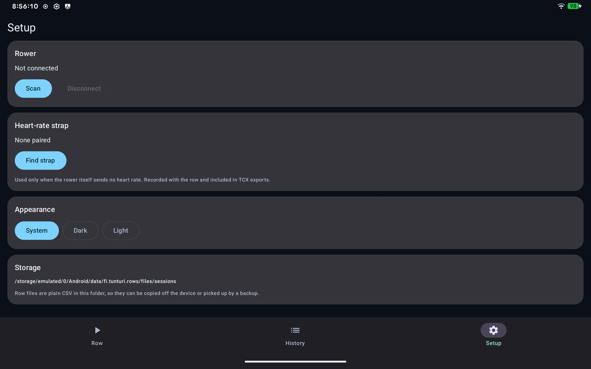

# Getting started

## Install

1. Download the latest `fellwater-….apk` from the [Releases page](https://github.com/OWNER/REPO/releases).
2. Open it on the tablet and allow installing from your browser or file manager when
   Android asks.
3. Launch **Fellwater** and allow **Nearby devices** (Bluetooth) and **Notifications**.

Fellwater needs Android 12 or newer and Bluetooth LE. It never asks for location.

## Connect your rower

1. Wake the console by pulling the handle a few times.
2. Open **Setup → Rower → Scan**. Rowers that advertise the standard fitness service
   are listed first.
3. Tap your rower. The status line at the top of the Row screen turns to
   *Connected: …*.

From then on Fellwater reconnects to the same rower by itself when it starts. If
the Bluetooth link drops mid-row it keeps retrying for about five minutes, and your
distance and strokes carry on where they were.

While connected the screen stays on and a small notification keeps the session alive
if you switch apps or the screen goes off.

## Your first row

1. On **Row**, tap **Choose video** (or see [Videos](videos.md) for streams and YouTube).
2. Optionally pick a **Goal**: 500 m, 2 km, 5 km, 10 km, or a custom distance.
3. Row. The video starts moving when you do.
4. Tap **Finish row** to save it to History, or **Discard**.

Saved rows become [racers](racing.md) for your next session.

!!! tip "Damper"
    The console does not report the damper setting, so set the **Damper** slider to
    match your machine. It is saved with the row.

{ .screen }
