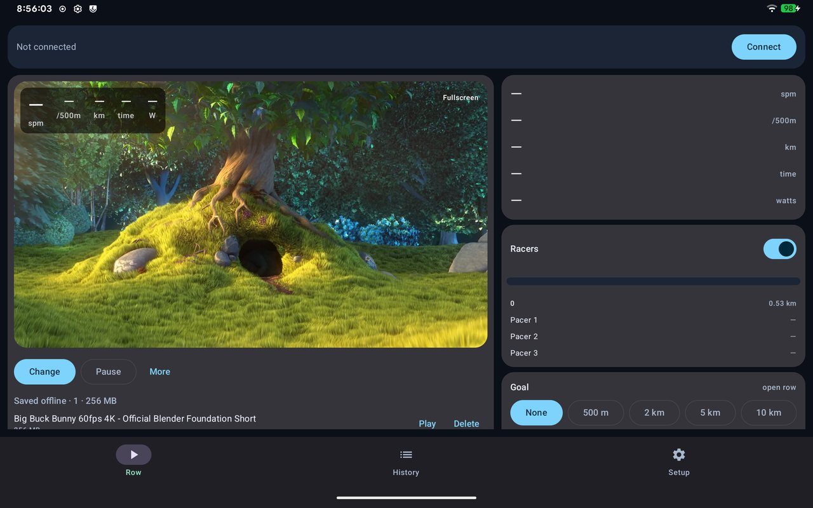
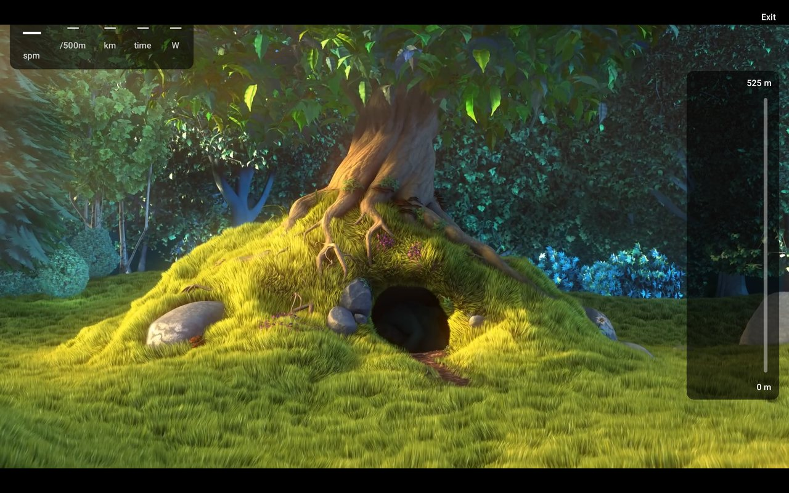

# Fellwater

**Row through video, on your own terms.** Fellwater is an Android app for indoor
rowing machines: pick a video, row, and the footage moves at your pace. Race your
own past rows, export to Strava, and keep everything on your own device. No account,
no subscription, no cloud.

It started as a replacement for the vendor app on Tunturi R60/R80 rowers, whose
console turned out to speak its own protocol rather than the standard one. Fellwater
speaks both. See [Supported rowers](hardware.md).

{ .screen }

## What it does

- **Video that follows you.** Local files, stream URLs (mp4, HLS, DASH) or YouTube
  links. Playback speed follows your pace, averaged over a few seconds so it does not
  lurch with every stroke. Stop rowing and the video pauses; your next stroke resumes it.
- **Live numbers over the footage.** Stroke rate, pace, distance, time, power, and
  heart rate when there is one. In fullscreen you can drag the panel anywhere.
- **Race yourself.** Your best row for the chosen distance, your recent rows, and
  virtual pacers, shown on a vertical course beside the video.
- **Never lose a row.** The row survives rotation and app switches, dropped Bluetooth
  links are reconnected, and a crash leaves an autosave you can recover.
- **Your data, as files.** Every row is a plain CSV on the device. Export CSV, or TCX
  for Strava and Garmin Connect.
- **Heart rate** from the console, or from any standard Bluetooth chest strap.

{ .screen }

## Get it

Download the latest APK from the
[Releases page](https://github.com/DylanBeMe/fellwater/releases) and install it on an Android 12
or newer phone or tablet, then follow [Getting started](getting-started.md).

!!! note "Not affiliated"
    Fellwater is an independent project. It is not made by or affiliated with Tunturi,
    First Degree Fitness or Kinomap. Screenshots show *Big Buck Bunny*
    (© Blender Foundation, CC BY 3.0).
